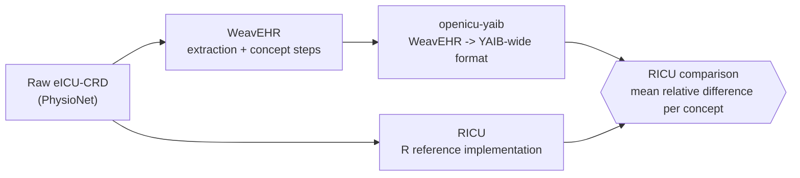

# Fidelity

Does WeavEHR's harmonised output agree, numerically, with RICU's reference
implementation for the same raw data? This experiment answers that for
eICU-CRD: every concept the two tools share is compared value-for-value over
the first 7 days of each stay, and the result is reported as a per-concept
mean relative difference against the project's own established **<1%**
threshold for "technically done".

Ported from the author's own prior validation work
([georginapetr/openicu-yaib-integration](https://github.com/georginapetr/openicu-yaib-integration)),
originally built against OpenICU, re-run here against the current WeavEHR
codebase and its own fresh eICU-CRD extraction.

## Pipeline



1. **`run_weavehr_pipeline.py`** — runs WeavEHR's `ExtractionStep` then
   `ConceptStep` for eICU-CRD into this experiment's own `output/` directory.
2. **`scripts/import_ricu_eicu.R`** (one-time, via `scripts/import_ricu_eicu.sbatch`)
   — imports the raw eICU-CRD download into `ricu`'s own cached format.
3. **`run_ricu_comparison.py`** — follows `openicu-yaib`'s own documented
   5-step workflow (`example/datasets/eicu-crd.ipynb` in that package) exactly:
   export RICU's reference values for the shared concepts, build WeavEHR's
   matching 7-day wide table (`aggregation_mode="ricu"`), compare. Each
   expensive step is skipped on re-run if its output already exists.

## Setup

```sh
cd experiments/fidelity
cp .env.example .env    # fill in your own machine-specific paths
source .env
```

Needs, in addition to the repo's own `uv sync`: a local checkout of
[georginapetr/openicu-yaib](https://github.com/georginapetr/openicu-yaib)
(for the R export resource script) and a conda environment with
`ricu`/`arrow`/`data.table` installed (see that repo's own setup notes).

## Running

```sh
sbatch scripts/import_ricu_eicu.sbatch     # one-time per machine
sbatch run_weavehr_pipeline.sbatch
sbatch run_ricu_comparison.sbatch          # after the above two complete
```

Results (per-concept comparison tables as CSV+JSON, and a summary plot) are
written to `results/`.

## Results (eICU-CRD)

**48/48 shared concepts land under the <1% mean relative difference
threshold** (largest: `mg`, 0.49%). RICU's own ICU-stay cohort for eICU-CRD
(`stay_windows()`) includes all 200,859 stays, identical to WeavEHR's; of
these, 196,340 have at least one recorded value for the compared concepts in
RICU's exported reference data. The remaining 4,519 have no recorded
measurement for any of the 48 compared concepts within the 7-day comparison
window in RICU's own data — a data-sparsity effect, not a cohort exclusion by
RICU, nor a disagreement between the two pipelines (verified by reproducing
the comparison's stay-overlap computation directly against RICU's cached
export: exact match, 196,340/4,519). Full
per-concept table and plot: `results/ricu_comparison_eicu-crd/value_diff.csv`
and `results/ricu_comparison_eicu-crd_per_concept.png`. All 10 underlying
report tables are saved as CSV+JSON in `results/ricu_comparison_eicu-crd/`
for independent inspection.

## Sources

The `<1%` mean-relative-difference threshold is this validation task's
agreed criterion; the comparison methodology applying it is documented, with
full results, in
[georginapetr/openicu-yaib-integration](https://github.com/georginapetr/openicu-yaib-integration#ricu-comparison-eicu-crd).
