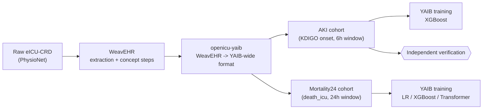

# Interoperability

Can WeavEHR's harmonised output actually replace RICU as the data-preparation
layer feeding YAIB's benchmark training, without silently getting something
wrong along the way? This experiment answers that for eICU-CRD by building
two YAIB benchmark tasks end-to-end from WeavEHR's own output and training
on them.

Ported from the author's own prior validation work
([georginapetr/openicu-yaib-integration](https://github.com/georginapetr/openicu-yaib-integration)),
originally built against OpenICU, re-run here against the current WeavEHR
codebase and its own fresh eICU-CRD extraction.

## Pipeline



1. **`run_weavehr_pipeline.py`** — runs WeavEHR's `ExtractionStep` then
   `ConceptStep` for eICU-CRD into this experiment's own `output/`
   directory (self-contained, same pattern as the fidelity experiment).
2. **Extraction chain** — `run_yaib_wide.py`, `run_yaib_dyn_rename.py`,
   `run_yaib_hospital_id.py`, `run_yaib_static.py`,
   `run_aki_concepts_corrected.py`: convert WeavEHR's concept output into
   YAIB-wide tables. The AKI concepts need their own step because they are
   categorical 0-3 KDIGO stages, not continuous values — see that script's
   own docstring for why the default hourly aggregation (mean) is wrong for
   them and max is used instead.
3. **Cohort builders** — `run_aki_eicu.py` (AKI, 6h-onset-prediction task)
   and `run_mortality24_eicu.py` (24h in-ICU mortality). Each ports its
   source R logic (`aki.R` / `mortality.R` from YAIB-cohorts) exactly,
   documented in-script with every known caveat and historical bug this
   logic has already had fixed once.
4. **`verify_aki_eicu.py`** — independent re-verification of the AKI
   cohort, run separately so its checks can't share a bug with the code
   they check. Not decorative: an earlier version of the cohort builder
   silently dropped stays with missing baseline data, caught only by this
   kind of independent cross-check.
5. **Training** — `train_aki_xgboost.sbatch` (XGBoost), and for
   Mortality24: `train_mortality24_lr.sbatch` (Logistic Regression),
   `train_mortality24_xgboost.sbatch` (XGBoost), and
   `train_mortality24_transformer.sbatch` (Transformer — the one genuine
   neural-network job here, run on GPU).
6. **`verify_train_aki_xgboost.py`** — independently recomputes AUC/PR
   mean and 95% CI from YAIB's own raw per-fold metric files and
   cross-checks against YAIB's own aggregate.

## Setup

```sh
cd experiments/interoperability
cp .env.example .env    # fill in your own machine-specific paths
source .env
```

Needs, in addition to the repo's own `uv sync`: a local clone of the
official [YAIB training codebase](https://github.com/rvandewater/YAIB)
with its own venv (a separate tool, not managed by this repo's uv
environment).

## Running

```sh
sbatch run_weavehr_pipeline.sbatch
# once that completes:
sbatch run_yaib_wide.sbatch
sbatch run_yaib_dyn_rename.sbatch
sbatch run_yaib_hospital_id.sbatch
sbatch run_aki_concepts_corrected.sbatch
# once run_yaib_wide.sbatch completes:
sbatch run_yaib_static.sbatch
# once the extraction chain above completes:
sbatch run_aki_eicu.sbatch
sbatch run_mortality24_eicu.sbatch
# once run_aki_eicu.sbatch completes:
sbatch verify_aki_eicu.sbatch
# once the cohorts are built:
sbatch train_aki_xgboost.sbatch
sbatch train_mortality24_lr.sbatch
sbatch train_mortality24_xgboost.sbatch
sbatch train_mortality24_transformer.sbatch
# once train_aki_xgboost.sbatch completes:
sbatch verify_train_aki_xgboost.sbatch
# optional, long-running (up to 36h safety ceiling): tuned AKI/XGBoost,
# reading from a frozen copy (results/aki/eicu-crd-tuning/) so it can't
# race a re-run of the cohort builder:
sbatch train_aki_xgboost_tuned.sbatch
```

Results (cohort attrition tables, the attrition funnel plot, training
metrics) are written to `results/`, `aki_training_logs/`, and
`mortality24_training_logs/`.

## Results (eICU-CRD)

- Hospital/stay universe: 200,859 stays across 208 hospitals, confirmed
  against the known reference count.
- **AKI cohort**: 159,185 stays retained (56,954 with any AKI onset,
  35.78% stay-level prevalence). All five independent verification checks
  passed (OR-vs-cascade equivalence, LOS bound, label spot checks,
  exclusion-6 spot check, missing-data retention). This is very close to
  but not exactly the author's previously published OpenICU-based figure
  (159,239) — the small difference (54 stays, ~0.03%) most likely reflects
  real upstream WeavEHR fixes made since that original run, not a porting
  error; the cohort logic itself is unchanged and independently verified.
- **Mortality24 cohort**: 113,233 stays retained, 6,273 positive labels
  (5.54% prevalence) — an exact match to the author's previously published
  figure.

### Training (YAIB, `icu-benchmarks`, 5 repetitions x 5 folds, seed 2222)

| Task | Model | AUROC | AUPRC |
|---|---|---|---|
| AKI | XGBoost | 0.802 (95% CI 0.801-0.803) | 0.233 (95% CI 0.230-0.236) |
| Mortality24 | XGBoost | 0.843 (95% CI 0.842-0.845) | 0.318 (95% CI 0.314-0.322) |
| Mortality24 | Transformer (GPU) | 0.836 (95% CI 0.832-0.841) | 0.305 (95% CI 0.297-0.313) |
| Mortality24 | Logistic Regression | 0.466 (95% CI 0.464-0.468) | 0.050 (95% CI 0.049-0.050) |

AKI/XGBoost's result is independently re-verified: `verify_train_aki_xgboost.py`
recomputes mean/CI directly from the 25 raw per-fold metric files using
YAIB's own aggregation formula and confirms an exact match against YAIB's
own reported aggregate.

**Logistic Regression's result is not a new finding or a porting defect.**
It reproduces a known, already-documented anomaly from the author's prior
OpenICU-based validation
([aidh-ms/WeavEHR#13](https://github.com/aidh-ms/WeavEHR/issues/13)):
AUROC at/below chance, with near-identical metrics across all 5 folds
within a repetition (confirmed again here: AUC 0.4594 in every one of
repetition 0's 5 folds) — consistent with a bug in YAIB's own LR/
class-weighting handling, not in this pipeline's cohort or training
invocation. Documented there as investigated and not pursued further;
left as-is here for the same reason, not reinvestigated in this port.

## Sources

- The cohort logic, exclusion criteria, and overall methodology are the
  author's own, established in
  [georginapetr/openicu-yaib-integration](https://github.com/georginapetr/openicu-yaib-integration).
- KDIGO AKI staging (the `aki`/`aki_creatinine`/`aki_urine_output`
  concepts this experiment's cohort is built from): Kellum, J.A. et al.
  (2012). KDIGO Clinical Practice Guideline for Acute Kidney Injury.
  *Kidney International Supplements*, 2(1), 1-138. The "worse-of"
  combination rule (max, not mean, across KDIGO criteria) is encoded
  directly in the reference implementation this project validates
  against: YAIB-cohorts' `ricu-extensions/callbacks/callback-kdigo.R`.
